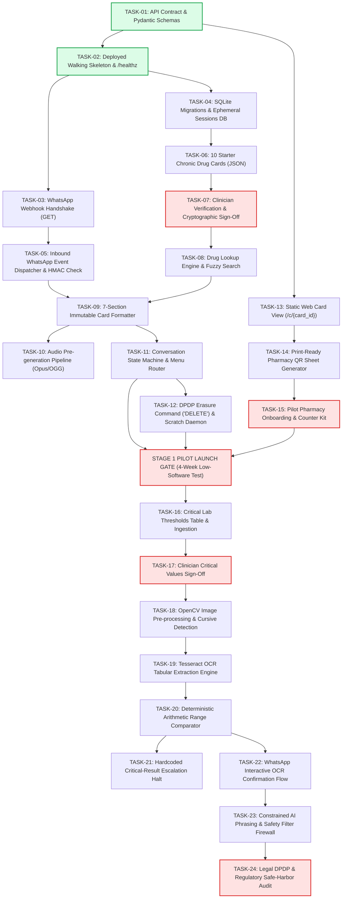

# Master Implementation Task List & Development Roadmap
## ReportSaathi: Plain-Language Medicine & Lab Report Explainer
*Document Version: 1.0 — Sprint & Pull Request Backlog*  
*Derived from `docs/05-prd.md`, `docs/06-architecture.md`, `docs/06a-api-contract.md`, and `docs/07-test-plan.md`*

---

## 1. Execution Principles & PR Guidelines

To maintain clinical safety, zero-defect deployment, and high maintainability, all tasks adhere to these rules:
1. **One Task = One Reviewable PR:** Each task is sized for a single pull request (< 400 lines of code changed, excluding fixtures/migrations).
2. **Contract First, Then Walking Skeleton:** No feature logic is built until API contracts, schema migrations, and the deployment skeleton are running in production.
3. **Deterministic Logic Over AI:** Any logic that touches arithmetic ranges, drug names, critical thresholds, or legal disclaimers must be written in deterministic code and covered by unit tests before conversational features are added.
4. **Human Approval Gates:** Tasks marked with **`[HUMAN APPROVAL REQUIRED]`** block subsequent stages until explicit sign-off from a named clinician, health-tech lawyer, or platform authority (Meta) is recorded.

---

## 2. Dependency & Parallel Execution Graph

The roadmap is structured across **4 parallel tracks**:
* **Track A (Core Platform & Backend):** Contracts → Webhooks → State Machine → Security.
* **Track B (Database & Clinical Governance):** Schema → Starter Drug Cards → Clinician Sign-Off.
* **Track C (Frontend & Pharmacy QR Companion):** Static Web Card → Audio Player → Pharmacy Print Assets.
* **Track D (Stage 2 Vision & OCR Pipeline):** Tesseract Engine → Handwriting Guard → Critical Range Gate → AI Smoothing.



---

## 3. Detailed Task Specifications

---

### Phase 1: Contract, Foundation & Deployed Walking Skeleton

#### TASK-01 · API Contract Models & Request/Response Validators
* **Status:** `COMPLETED` (PR Branch: `task-01-skeleton`)
* **Owner:** `backend`
* **Requirements:** `API-1`, `API-2`, `API-3`, `API-4`, `API-5`, `API-6`
* **Tests:** `TC-API-01`, `TC-API-02`, `TC-API-03`
* **Dependencies:** None (First task)
* **Human Approval:** None
* **Scope:**
  * Define strict Pydantic v2 data models for Meta WhatsApp webhook payloads (`Entry`, `Change`, `Message`, `ButtonReply`).
  * Define internal response schemas for Medicine Card Lookup (`MedicineCardResponse`), Lab Extraction (`LabExtractResponse`), and DPDP Purge (`DataPurgeResponse`) according to `docs/06a-api-contract.md`.
  * Add unit tests asserting validation passes on compliant JSON and rejects malformed payloads.
* **Definition of Done (DoD):**
  * All schemas compile cleanly; 100% test pass on payload serialization/deserialization.
  * PR opened with schema definitions, contract unit tests, shared TypeScript types, and automated smoke test.
* **Completion Summary:**
  * Implemented Pydantic v2 models in `backend/app/schemas/` (`whatsapp.py`, `medicine.py`, `lab_report.py`, `user.py`, `health.py`).
  * Implemented parallel TypeScript contracts in `shared/types/`.
  * Configured backend tests with 13 passing contract unit and smoke tests.
  * Verified SQLite database connection in WAL mode with live readback via `GET /api/health`.
  * Setup frontend with React/TypeScript/Vite calling `GET /api/health` and displaying DB value.
  * Configured GitHub Actions CI pipeline and Docker Compose staging deployment.

---

#### TASK-02 · Deployed Walking Skeleton & Automated Health Check
* **Owner:** `backend`
* **Requirements:** `NFR-8`, `NFR-11`
* **Tests:** Monitored via `GET /healthz`
* **Dependencies:** `TASK-01`
* **Human Approval:** None
* **Scope:**
  * Create base FastAPI application scaffold with Dockerfile and `docker-compose.yml` (FastAPI + Caddy v2).
  * Implement `GET /healthz` endpoint returning `{ "status": "healthy", "env": "production" }`.
  * Setup Caddy reverse proxy with automated Let's Encrypt TLS 1.3 configuration.
  * Deploy skeleton to target Indian VPS hosting node; verify public SSL connectivity.
* **Definition of Done (DoD):**
  * `curl -I https://api.reportsaathi.in/healthz` returns HTTP `200 OK` with valid TLS certificate.
  * CI pipeline executes linter and pytest on every push.

---

#### TASK-03 · WhatsApp Webhook Handshake Verification Endpoint
* **Owner:** `backend`
* **Requirements:** `API-1`
* **Tests:** `TC-API-01`
* **Dependencies:** `TASK-02`
* **Human Approval:** None
* **Scope:**
  * Implement `GET /api/v1/whatsapp/webhook` handler.
  * Validate `hub.mode == "subscribe"` and `hub.verify_token == WHATSAPP_VERIFY_TOKEN`.
  * Return raw `hub.challenge` integer string with HTTP 200 on success; HTTP 403 on mismatch.
* **Definition of Done (DoD):**
  * Webhook handshake passes Meta Graph API verification dashboard in test mode.
  * Unit tests cover valid token, invalid token, and missing challenge parameters.

---

#### TASK-04 · SQLite Database Migrations & Session Schema
* **Owner:** `database`
* **Requirements:** `FR-1`, `FR-2`, `FR-16`, `NFR-10`
* **Tests:** `TC-FR16-01`, `TC-SEC-01`
* **Dependencies:** `TASK-02`
* **Human Approval:** None
* **Scope:**
  * Implement database migration scripts (using Alembic or lightweight native SQLite runner) for:
    1. `medicines`: Store pre-vetted cards, aliases, clinician sign-off metadata.
    2. `user_sessions`: Ephemeral state machine tracking (`wa_phone_hash`, `active_step`, `last_interaction`).
    3. `missed_queries`: Unmatched search query audit log.
  * Enforce foreign keys, indexes on `generic_name` and `wa_phone_hash`.
  * Implement phone number hashing utility: `SHA256(phone + DATA_SALT)`.
* **Definition of Done (DoD):**
  * Migration runs idempotently from scratch; rollback verified.
  * Zero raw phone numbers stored in database.

---

### Phase 2: Database & Seed Content (Stage 1 Scope)

#### TASK-05 · Inbound Webhook Event Dispatcher & HMAC-SHA256 Verifier
* **Owner:** `backend`
* **Requirements:** `API-2`, `NFR-11`
* **Tests:** `TC-SEC-03`
* **Dependencies:** `TASK-03`, `TASK-04`
* **Human Approval:** None
* **Scope:**
  * Implement `POST /api/v1/whatsapp/webhook` route.
  * Add cryptographic middleware to verify `X-Hub-Signature-256` header against `WHATSAPP_APP_SECRET`.
  * Parse incoming events and dispatch to corresponding handler (`text`, `interactive`, or `image`).
  * Return immediate `HTTP 200 OK` to Meta to acknowledge receipt within 500ms.
* **Definition of Done (DoD):**
  * Rejects forged or unsigned webhook calls with HTTP 403.
  * Unit tests assert dispatch routing for message types.

---

#### TASK-06 · 10 Starter Chronic Drug Content Cards (Bilingual JSON)
* **Owner:** `database` (Medical Writer)
* **Requirements:** `FR-2`, `FR-3`, `FR-4`, `FR-5`
* **Tests:** `TC-FR3-01`, `TC-FR4-01`, `TC-FR5-01`
* **Dependencies:** `TASK-04`
* **Human Approval:** None (Draft creation)
* **Scope:**
  * Author structured JSON cards for the 10 most common chronic drugs in Karnataka:
    1. Metformin (Glycomet, Glucophage)
    2. Amlodipine (Amlong, Stamlo)
    3. Telmisartan (Telma, Telmikem)
    4. Atorvastatin (Atorva, Storvas)
    5. Levothyroxine (Thyronorm, Eltroxin)
    6. Glimepiride (Amaryl, Glimestar)
    7. Losartan (Repace, Covance)
    8. Hydrochlorothiazide (Aquazide)
    9. Pantoprazole (Pan-40, Pantocid)
    10. Aspirin 75mg (Ecosprin)
  * Ensure all cards contain the mandatory 7 sections and exact Kannada translations.
* **Definition of Done (DoD):**
  * All 10 JSON cards pass automated structural validation against `FR-3` schema.

---

#### TASK-07 · Clinician Verification & Four-Eye Sign-Off Workflow
* **Owner:** `database`
* **Requirements:** `FR-2`, `SR-5`
* **Tests:** `TC-FR2-01`
* **Dependencies:** `TASK-06`
* **Human Approval:** **`[HUMAN APPROVAL REQUIRED]`** (Named MBBS/MD Clinician)
* **Scope:**
  * Implement verification script that checks clinician sign-off fields: `reviewed_by_clinician_name`, `clinician_reg_number`, `reviewed_at`, `next_review_due`.
  * Conduct formal review meeting with pilot partner clinician (MBBS/MD registered with Karnataka Medical Council).
  * Clinician verifies: (a) Purpose/administration accuracy, (b) Red flags, (c) 1–3 doctor questions.
  * Run database seed script to populate `medicines` table with `is_active = 1`.
* **Definition of Done (DoD):**
  * Clinician signature and KMC registration number recorded in migration; cards marked active.
  * Database unit tests confirm unverified cards cannot be queried.

---

#### TASK-08 · Drug Lookup Engine & Fuzzy Brand Matcher
* **Owner:** `backend`
* **Requirements:** `FR-1`, `FR-7`, `NFR-1`
* **Tests:** `TC-FR1-01`, `TC-FR1-02`, `TC-FR7-01`
* **Dependencies:** `TASK-04`, `TASK-07`
* **Human Approval:** None
* **Scope:**
  * Implement medicine query resolver in Python:
    1. Exact case-insensitive match on `generic_name`.
    2. JSON array search on `brand_aliases`.
    3. Levenshtein distance matching (threshold ≤ 2) for typo tolerance.
    4. Unicode phonetic matching for Romanized Kannada spelling.
  * If no match found, route to `missed_queries` logger and return fallback code.
* **Definition of Done (DoD):**
  * Resolves `"Glycomet 500"`, `"glycomet"`, `"Metformin"`, and `"ಥೈರೋನಾರ್ಮ್"` to correct card ID in < 50ms.
  * Unit tests achieve 100% pass on drug lookup test matrix.

---

### Phase 3: Conversational WhatsApp Bot & Delivery Engine (Stage 1 Scope)

#### TASK-09 · 7-Section Immutable Card Formatter & Safety Footer
* **Owner:** `backend`
* **Requirements:** `FR-3`, `FR-4`, `FR-5`, `SR-3`, `SR-4`
* **Tests:** `TC-FR3-01`, `TC-FR4-01`, `TC-FR5-01`, `TC-SAFE-03`
* **Dependencies:** `TASK-08`
* **Human Approval:** None
* **Scope:**
  * Build template rendering engine converting medicine JSON to WhatsApp markdown (`*bold*`, `━━━━`, emojis).
  * Format Kannada primary text with English companion.
  * Append immutable clinical governance footer: Doctor name, KMC Reg No, Date, and *"Drug interactions not checked"*.
  * Inject interactive quick-reply buttons: `[ 🔊 Listen Audio ]` and `[ 📋 Main Menu ]`.
* **Definition of Done (DoD):**
  * Formatted output verified visually against Screen W4 specification in `docs/04-design.md`.
  * Unit tests verify all 7 sections and footer are present without string truncations.

---

#### TASK-10 · Audio Pre-Generation Pipeline (Opus/OGG Voice Notes)
* **Owner:** `backend` / `AI`
* **Requirements:** `FR-6`, `NFR-3`
* **Tests:** `TC-FR6-01`
* **Dependencies:** `TASK-07`, `TASK-09`
* **Human Approval:** None
* **Scope:**
  * Build offline audio generation utility using Google TTS (`gTTS`) or local neural TTS (`piper-tts`) for Kannada voice synthesis.
  * Transcode audio into WhatsApp-optimized Opus mono codec in OGG container (24 kbps).
  * Save static audio assets into `/app/static/audio/{med_id}_kn.ogg` (< 150 KB each).
  * Implement WhatsApp media upload and caching handler to transmit voice notes upon user button tap.
* **Definition of Done (DoD):**
  * All 10 starter cards have verified audio files in repository.
  * Tap on audio button delivers voice note to WhatsApp in < 2.0 seconds.

---

#### TASK-11 · WhatsApp Conversational State Machine & Menu Router
* **Owner:** `backend`
* **Requirements:** `FR-16`, `FR-17`, `NFR-9`
* **Tests:** `TC-FR16-01`, `TC-FR17-01`, `TC-FAIL-02`
* **Dependencies:** `TASK-05`, `TASK-08`, `TASK-09`
* **Human Approval:** None
* **Scope:**
  * Implement state machine for user session lifecycle:
    * `W1`: Language selection (`kn` / `en`).
    * `W2`: Main menu navigation (`Medicine Info` vs. `Lab Report`).
    * `W3` / `W4`: Medicine input parsing and card delivery.
    * `W5`: Unlisted query handling with pharmacist fallback.
    * `W6`: System error graceful recovery.
  * Handle session reset after 15 minutes of inactivity.
  * Restrict interactive reply buttons to ≤ 3 per message.
* **Definition of Done (DoD):**
  * End-to-end conversation flows seamlessly in staging WhatsApp sandbox.
  * Session resets cleanly on timeout.

---

#### TASK-12 · DPDP Data Erasure Engine & Transient Scratch Daemon
* **Owner:** `backend`
* **Requirements:** `FR-18`, `NFR-10`
* **Tests:** `TC-FR18-01`, `TC-SEC-02`
* **Dependencies:** `TASK-04`, `TASK-11`
* **Human Approval:** None
* **Scope:**
  * Implement command interceptor for `"DELETE"` and `"ಅಳಿಸು"`.
  * Wipe all session records matching user's phone hash from SQLite.
  * Configure system cron daemon inside container:
    `find /tmp/scratch -type f -mmin +10 -delete`
  * Add automated integration test verifying files older than 10 minutes are deleted.
* **Definition of Done (DoD):**
  * Texting "DELETE" purges session and returns confirmation message.
  * Test verifying scratch file shredding passes cleanly.

---

### Phase 4: Web Companion & Pharmacy Distribution Assets (Stage 1 Scope)

#### TASK-13 · Static Responsive Web Medicine Card Endpoint (`/c/{card_id}`)
* **Owner:** `frontend`
* **Requirements:** `NFR-4`, `NFR-5`, `NFR-6`, `NFR-7`, `API-6`
* **Tests:** `TC-NFR-03`, `TC-NFR-04`
* **Dependencies:** `TASK-07`
* **Human Approval:** None
* **Scope:**
  * Build single-page responsive HTML template matching Screen C1 in `docs/04-design.md`.
  * Enforce CSS typography: `Noto Sans Kannada`, body font `18px`, line-height `1.5×` (27px), high-contrast tokens (`#1A1A1A` on `#FAFAF8`).
  * Enforce 48 × 48 dp minimum touch targets on all buttons.
  * Zero external JavaScript frameworks (pure HTML5 + embedded CSS); total payload < 100 KB.
  * Serve via FastAPI with aggressive HTTP caching (`Cache-Control: public, max-age=86400`).
* **Definition of Done (DoD):**
  * Lighthouse score: Performance 100, Accessibility 100.
  * Verified responsive render across mobile viewports (360px to 480px).

---

#### TASK-14 · Print-Ready Pharmacy QR Code Card Generator
* **Owner:** `frontend`
* **Requirements:** `Stage 1 Pilot Delivery` (docs/01-problem.md)
* **Tests:** Manual physical print audit
* **Dependencies:** `TASK-13`
* **Human Approval:** None
* **Scope:**
  * Create printable SVG/PDF template for 5" × 7" physical counter cards.
  * Front: Kannada explanation + Red flags + QR code linking to `/c/{card_id}`.
  * Back: English companion translation + WhatsApp QR code to start chat.
  * High-contrast black and deep green layout for low-cost thermal/inkjet pharmacy printing.
* **Definition of Done (DoD):**
  * Printable PDF generated for all 10 starter medicines.
  * QR codes scan successfully on low-cost Android cameras.

---

#### TASK-15 · Pharmacy Pilot Deployment & Chemist Onboarding Kit
* **Owner:** `backend` (Operations)
* **Requirements:** `Stage 1 Success Gates` (docs/01-problem.md)
* **Tests:** `Manual Field Verification`
* **Dependencies:** `TASK-11`, `TASK-14`
* **Human Approval:** **`[HUMAN APPROVAL REQUIRED]`** (Partner Pharmacists & Principal Investigator)
* **Scope:**
  * Deliver counter stands and laminated card sets to 2 pilot retail pharmacies in Karnataka.
  * Train pharmacists and dispensary staff on distributing cards when dispensing chronic prescriptions.
  * Setup physical card distribution tracking log and 3-question exit interview clipboard.
* **Definition of Done (DoD):**
  * Pilot live at 2 pharmacy counters; first 20 physical cards taken by patients.

---

### Phase 5: Stage 2 Lab Report OCR & Verification Pipeline

*(Note: Execution of Phase 5 is contingent on passing Stage 1 Success Thresholds)*

#### TASK-16 · Lab Tests Catalog & Hardcoded Critical Escalation Table
* **Owner:** `database`
* **Requirements:** `FR-10`, `FR-13`, `SR-2`
* **Tests:** `TC-FR13-01`, `TC-FR13-02`
* **Dependencies:** `TASK-04`
* **Human Approval:** None (Draft schema)
* **Scope:**
  * Create and seed `lab_tests` table (FBS, PPBS, HbA1c, Creatinine, Potassium, Sodium, Platelets, TSH).
  * Create `critical_lab_thresholds` table populated with emergency thresholds from `docs/06b-safety-rules.md`.
  * Add unit tests ensuring critical table queries execute in < 5ms.
* **Definition of Done (DoD):**
  * Database migration compiles; critical thresholds seeded correctly.

---

#### TASK-17 · Clinician Critical Values Sign-Off Gate
* **Owner:** `database`
* **Requirements:** `FR-13`, `SR-2`, `SR-5`
* **Tests:** `TC-FR13-01`
* **Dependencies:** `TASK-16`
* **Human Approval:** **`[HUMAN APPROVAL REQUIRED]`** (Consultant Pathologist / MD Physician)
* **Scope:**
  * Present critical threshold values to partner pathologist.
  * Formally sign off on acute panic levels (e.g. Potassium > 6.2 mEq/L, Glucose < 55 mg/dL, Platelets < 30,000 /µL).
  * Record signed clinical protocol in repository governance directory.
* **Definition of Done (DoD):**
  * Formal written sign-off document committed; database thresholds locked.

---

#### TASK-18 · OpenCV Image Pre-Processing & Cursive Handwriting Classifier
* **Owner:** `backend` / `AI`
* **Requirements:** `FR-8`, `FR-9`, `SR-5`
* **Tests:** `TC-FR8-01`, `TC-FR9-01`
* **Dependencies:** `TASK-05`
* **Human Approval:** None
* **Scope:**
  * Implement OpenCV image pre-processing pipeline (grayscale, deskew, adaptive Otsu thresholding, noise removal).
  * Implement handwriting classifier heuristic:
    * Analyze stroke variance and OCR word confidence.
    * If confidence < 70% or cursive detected, reject document.
    * Trigger Screen W6 refusal: *"Cannot read handwritten notes. Please ask your pharmacist."*
* **Definition of Done (DoD):**
  * Successfully rejects `fixture_09_handwritten_prescription.json` with 100% reliability.
  * Successfully accepts printed report images.

---

#### TASK-19 · Tabular OCR Parsing Engine (Tesseract OCR v5.3+)
* **Owner:** `backend`
* **Requirements:** `FR-10`, `NFR-2`
* **Tests:** `TC-FR10-01`, `TC-FAIL-03`, `TC-EDGE-01`
* **Dependencies:** `TASK-18`
* **Human Approval:** None
* **Scope:**
  * Configure Tesseract OCR v5.3+ with `tessdata_fast` models (`eng` + `kan`).
  * Implement regex tabular extractor:
    * Regex pattern matching for parameter name, numeric value, unit, and printed range min/max.
  * Test against all 10 fixtures in `tests/fixtures/`.
* **Definition of Done (DoD):**
  * Achieves ≥ 90% parameter extraction accuracy across printed fixtures (`fixture_01`, `fixture_02`, `fixture_03`, `fixture_05`, `fixture_06`, `fixture_07`).

---

#### TASK-20 · Deterministic Range Comparator & Critical Escalation Interceptor
* **Owner:** `backend`
* **Requirements:** `FR-12`, `FR-13`, `SR-2`
* **Tests:** `TC-FR12-01`, `TC-FR13-01`, `TC-EDGE-02`
* **Dependencies:** `TASK-16`, `TASK-17`, `TASK-19`
* **Human Approval:** None
* **Scope:**
  * Implement mathematical range evaluation:
    `status = "BELOW_RANGE" if val < min else "ABOVE_RANGE" if val > max else "NORMAL"`
  * Evaluate value against `critical_lab_thresholds`:
    * If critical threshold breached, immediately raise `CriticalAbnormalityException`.
    * Terminate all subsequent AI pipelines.
    * Construct Screen W8 Emergency Escalation message.
* **Definition of Done (DoD):**
  * 100% pass on `fixture_03_critical_hyperkalemia.json` and `fixture_04_critical_hypoglycemia.json` triggering Screen W8. Zero exceptions leaked.

---

#### TASK-21 · WhatsApp Interactive OCR Confirmation Flow
* **Owner:** `backend`
* **Requirements:** `FR-11`, `FR-15`
* **Tests:** `TC-FR11-01`, `TC-FR15-01`
* **Dependencies:** `TASK-11`, `TASK-20`
* **Human Approval:** None
* **Scope:**
  * Build confirmation UX: After OCR extraction, send WhatsApp interactive message displaying detected test names, numbers, and printed ranges.
  * Present interactive buttons: `[ ✅ Yes, Explain ]` and `[ ✏️ Edit Numbers ]`.
  * Enforce safety block: System must NEVER proceed to explanation generation until user explicitly taps `[ Yes, Explain ]`.
* **Definition of Done (DoD):**
  * Integration test confirms pipeline pauses at confirmation step and resumes only upon button tap.

---

### Phase 6: Constrained AI Explanation & Safety Firewall

#### TASK-22 · Constrained Plain-Language Assembly & Prompt Firewall
* **Owner:** `AI` / `backend`
* **Requirements:** `FR-14`, `SR-1`, `SR-4`
* **Tests:** `TC-FR14-01`, `TC-SAFE-01`, `TC-SAFE-02`
* **Dependencies:** `TASK-21`
* **Human Approval:** None
* **Scope:**
  * Implement template-based explanation assembler (0% AI default path).
  * (Optional LLM path): If `ENABLE_AI_SMOOTHING=true`, invoke strictly constrained local LLM with system prompt:
    * Input contains ONLY normalized parameters and status (e.g. `{"test": "FBS", "status": "ABOVE_RANGE"}`).
    * System prompt strictly prohibits clinical diagnosis words (`"You have diabetes"`).
  * Append exactly 1–3 pre-approved doctor questions.
* **Definition of Done (DoD):**
  * Passes adversarial jailbreak tests `TC-SAFE-01` and `TC-SAFE-02` with 0 diagnostic leaks.

---

#### TASK-23 · Deterministic Post-Generation Compliance Regex Filter
* **Owner:** `backend`
* **Requirements:** `SR-1`, `SR-3`, `SR-4`, `NFR-12`
* **Tests:** `TC-SAFE-01`, `TC-SAFE-02`, `TC-SAFE-05`
* **Dependencies:** `TASK-22`
* **Human Approval:** None
* **Scope:**
  * Implement post-generation regex assertion firewall scanning all outgoing text before transmission:
    * Block diagnostic assertions: `r"(you have|diagnosed with|suffering from|ಮಧುಮೇಹವಿದೆ)"`
    * Block dosage alteration verbs: `r"(increase dose|decrease dose|take two|double the)"`
  * If forbidden pattern detected, drop generated text and fallback to hardcoded safe template.
  * Verify PII scrubber: Ensure no phone numbers or patient names are sent to any external API.
* **Definition of Done (DoD):**
  * Automated test asserting 1,000 synthetic adversarial outputs are intercepted and sanitized.

---

### Phase 7: Governance, Legal Audit & Meta Verification

#### TASK-24 · Legal DPDP & Regulatory Safe-Harbor Compliance Review
* **Owner:** `backend` (Legal Counsel)
* **Requirements:** `NFR-10`, `NFR-11`, `SR-1`, `SR-3`
* **Tests:** Regulatory Compliance Audit
* **Dependencies:** `TASK-12`, `TASK-23`
* **Human Approval:** **`[HUMAN APPROVAL REQUIRED]`** (Health-Tech Advocate / DPDP Legal Counsel)
* **Scope:**
  * Legal review of:
    1. DPDP Act 2023 unbundled consent notice copy (Screen W7).
    2. CDSCO SaMD safe-harbor positioning (strictly educational, no clinical decision support).
    3. Drugs and Magic Remedies Act compliance (no disease cure claims).
    4. Ephemeral data shredding verification audit log.
* **Definition of Done (DoD):**
  * Formal legal opinion letter received confirming educational safe-harbor status.

---

#### TASK-25 · Meta WhatsApp Cloud API Template Registration & Approval
* **Owner:** `backend` (Operations)
* **Requirements:** `API-1`, `API-2`, `FR-17`
* **Tests:** Meta Production Channel Audit
* **Dependencies:** `TASK-24`
* **Human Approval:** **`[HUMAN APPROVAL REQUIRED]`** (Meta Business Review)
* **Scope:**
  * Submit utility template messages to Meta WhatsApp Business Manager:
    * Welcome message (`welcome_kn_v1`)
    * Medicine card delivery (`med_card_kn_v1`)
    * Emergency escalation alert (`critical_alert_kn_v1`)
  * Complete Meta Business verification for ReportSaathi registered entity.
* **Definition of Done (DoD):**
  * Green Verified Business checkmark or Approved status granted on Meta WhatsApp Business dashboard.

---

## 4. Master Task Mapping Matrix

| Task ID | Task Title | Owner | Requirements | Test Mapping | Human Approval? |
|---|---|---|---|---|---|
| **TASK-01** | API Contract Models & Schemas | `backend` | `API-1`–`API-6` | `TC-API-01`–`03` | No |
| **TASK-02** | Deployed Skeleton & `/healthz` | `backend` | `NFR-8`, `NFR-11` | Monitored | No |
| **TASK-03** | Webhook Handshake Verification | `backend` | `API-1` | `TC-API-01` | No |
| **TASK-04** | SQLite Migrations & Sessions DB | `database`| `FR-1`, `FR-2`, `FR-16` | `TC-FR16-01`, `TC-SEC-01` | No |
| **TASK-05** | Inbound Webhook Event Dispatcher | `backend` | `API-2`, `NFR-11` | `TC-SEC-03` | No |
| **TASK-06** | 10 Starter Chronic Drug Cards | `database`| `FR-2`–`FR-5` | `TC-FR3-01`, `TC-FR4-01` | No |
| **TASK-07** | Clinician Sign-Off Workflow | `database`| `FR-2`, `SR-5` | `TC-FR2-01` | **YES (Clinician)** |
| **TASK-08** | Drug Lookup Engine & Fuzzy Match | `backend` | `FR-1`, `FR-7`, `NFR-1` | `TC-FR1-01`, `TC-FR1-02` | No |
| **TASK-09** | 7-Section Immutable Card Formatter | `backend` | `FR-3`–`FR-5`, `SR-3` | `TC-FR3-01`, `TC-SAFE-03` | No |
| **TASK-10** | Audio Pre-Generation Pipeline | `backend`/`AI` | `FR-6`, `NFR-3` | `TC-FR6-01` | No |
| **TASK-11** | Conversation State Machine & Router| `backend` | `FR-16`, `FR-17`, `NFR-9` | `TC-FR16-01`, `TC-FAIL-02`| No |
| **TASK-12** | DPDP Erasure Command & Daemon | `backend` | `FR-18`, `NFR-10` | `TC-FR18-01`, `TC-SEC-02` | No |
| **TASK-13** | Static Web Card View (`/c/{id}`) | `frontend` | `NFR-4`–`NFR-7`, `API-6` | `TC-NFR-03`, `TC-NFR-04` | No |
| **TASK-14** | Print Pharmacy QR Card Generator | `frontend` | `Stage 1 Scope` | Manual Print Audit | No |
| **TASK-15** | Pharmacy Pilot Kit & Deployment | `backend` | `Stage 1 Success Gates` | Field Verification | **YES (Chemist/PI)** |
| **TASK-16** | Lab Tests & Critical Tables | `database`| `FR-10`, `FR-13`, `SR-2` | `TC-FR13-01` | No |
| **TASK-17** | Clinician Critical Threshold Sign-Off| `database`| `FR-13`, `SR-2`, `SR-5` | `TC-FR13-01` | **YES (Pathologist)** |
| **TASK-18** | OpenCV Pre-process & Cursive Guard | `backend`/`AI` | `FR-8`, `FR-9`, `SR-5` | `TC-FR8-01`, `TC-FR9-01` | No |
| **TASK-19** | Tabular OCR Engine (Tesseract) | `backend` | `FR-10`, `NFR-2` | `TC-FR10-01`, `TC-FAIL-03`| No |
| **TASK-20** | Deterministic Range & Critical Halt| `backend` | `FR-12`, `FR-13`, `SR-2` | `TC-FR12-01`, `TC-FR13-01`| No |
| **TASK-21** | WhatsApp Interactive OCR Confirmation| `backend` | `FR-11`, `FR-15` | `TC-FR11-01`, `TC-FR15-01`| No |
| **TASK-22** | Constrained Plain-Language Assembly | `AI`/`backend` | `FR-14`, `SR-1`, `SR-4` | `TC-FR14-01`, `TC-SAFE-01`| No |
| **TASK-23** | Post-Generation Regex Safety Filter| `backend` | `SR-1`, `SR-3`, `SR-4` | `TC-SAFE-01`, `TC-SAFE-02`| No |
| **TASK-24** | Legal DPDP & Regulatory Audit | `backend` | `NFR-10`, `NFR-11`, `SR-1`| Legal Audit Report | **YES (Legal Counsel)** |
| **TASK-25** | Meta WhatsApp Template Approval | `backend` | `API-1`, `API-2`, `FR-17` | Meta Platform Review | **YES (Meta Platforms)** |

---

## 5. Parallel Execution Schedule & Sprints

```
SPRINT 1 (Week 1): Foundation, Walking Skeleton & Contracts
Track A: TASK-01 (Schemas) ──> TASK-02 (Skeleton) ──> TASK-03 (Webhook Handshake)
Track B: TASK-04 (DB Migrations)
Track C: TASK-13 (Web Card View)

SPRINT 2 (Week 2): Stage 1 Clinical Content & Core Bot
Track A: TASK-05 (Webhook Dispatcher) ──> TASK-08 (Lookup) ──> TASK-09 (Card Formatter)
Track B: TASK-06 (10 Cards Draft) ──> [TASK-07: Clinician Sign-Off]
Track C: TASK-10 (Audio Generation) ──> TASK-14 (Print QR Cards)

SPRINT 3 (Week 3): State Machine, DPDP & Pilot Launch
Track A: TASK-11 (State Machine) ──> TASK-12 (Data Erasure)
Track C: [TASK-15: Pharmacy Pilot Deployment] ──> STAGE 1 PILOT BEGINS (4 Weeks)

SPRINT 4 (Week 4–7): Stage 1 Field Operations & Stage 2 Preparation
Track D (In Parallel): TASK-16 (Lab DB) ──> [TASK-17: Critical Sign-Off] ──> TASK-18 (OpenCV)
                      TASK-19 (OCR Engine) ──> TASK-20 (Range Comparator)

SPRINT 5 (Week 8): Stage 2 Safety Firewall & Legal Verification
Track D: TASK-21 (OCR Confirmation UX) ──> TASK-22 (AI Assembly) ──> TASK-23 (Regex Firewall)
Governance: [TASK-24: Legal DPDP Audit] ──> [TASK-25: Meta Template Approval]
```

---
*End of Master Implementation Task List (`docs/08-tasks.md`).*
